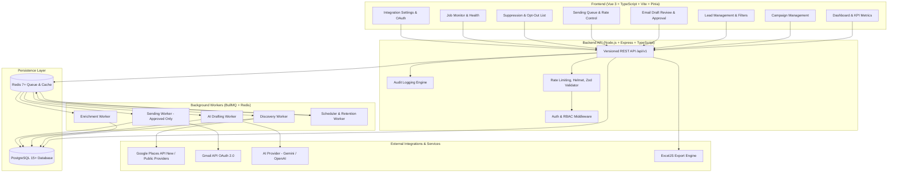

# Wardell Lead Engine — Architecture & Implementation Specification
## AI-Assisted Business Lead Generation & Email Outreach Automation Platform

**Author:** Lead Software Architect & Technical Project Manager  
**Date:** October 2026  
**Status:** Approved for Implementation (Phase 0 Complete)

---

## 1. Executive Summary & Objective

**Wardell Lead Engine** is an enterprise-grade, compliant B2B lead generation and outreach automation platform engineered for **Wardell Tech**. The system targets Indonesian businesses that need digital transformation services, including custom web application development, company profile websites, business process digitization, and internal operational dashboards.

The platform provides an end-to-end controlled pipeline:
1. **Targeted Discovery:** Search authorized business directories and location APIs across Indonesian provinces and regencies/cities.
2. **Provenance & Enrichment:** Verify public business contact information, recording exact source URLs and collection timestamps.
3. **AI Drafting with Guardrails:** Generate natural Indonesian outreach drafts via structured AI prompts based strictly on verified business facts.
4. **Mandatory Human-in-the-Loop Review:** Draft editing, approval, and rejection workflow.
5. **Compliant Outreach:** Automated queuing with pre-flight suppression checks, daily caps, jittered delays, and Gmail API (OAuth 2.0).
6. **Observability & Analytics:** Distributed BullMQ queues, scheduled recurrence via Jakarta timezone, audit logging, and secure ExcelJS exports.

---

## 2. System Architecture



---

## 3. Recommended Project Directory Layout

```
/Users/syahbintang/automatedscrapdata/
├── backend/
│   ├── prisma/
│   │   ├── schema.prisma             # Normalized relational schema
│   │   ├── migrations/               # Versioned SQL migrations
│   │   └── seed.ts                   # Initial admin & Indonesian provinces/cities dataset
│   ├── src/
│   │   ├── config/                   # Zod environment validation, logger, constants
│   │   │   ├── env.ts
│   │   │   └── logger.ts
│   │   ├── db/                       # Prisma client instance & extensions
│   │   ├── middleware/               # Auth, rate-limit, audit, error handler
│   │   ├── modules/
│   │   │   ├── auth/                 # Authentication, JWT, roles
│   │   │   ├── campaigns/            # Campaign CRUD & target criteria
│   │   │   ├── leads/                # Lead CRUD, deduplication, qualification
│   │   │   ├── discovery/            # Provider abstraction & implementations
│   │   │   │   ├── provider.interface.ts
│   │   │   │   ├── google-places.provider.ts
│   │   │   │   └── public-directory.provider.ts
│   │   │   ├── enrichment/           # Website scraper/verifier with robots.txt check
│   │   │   ├── ai/                   # AI provider abstraction, prompt templates
│   │   │   │   ├── ai.interface.ts
│   │   │   │   └── gemini.provider.ts
│   │   │   ├── sending/              # Gmail OAuth, message builder, pre-flight checks
│   │   │   ├── suppression/          # Opt-out & suppression list management
│   │   │   ├── export/               # ExcelJS export with formula injection prevention
│   │   │   ├── audit/                # Structured audit logging
│   │   │   └── jobs/                 # Queue factories, BullMQ job definitions
│   │   ├── workers/                  # Independent worker entrypoints
│   │   │   ├── discovery.worker.ts
│   │   │   ├── enrichment.worker.ts
│   │   │   ├── drafting.worker.ts
│   │   │   ├── sending.worker.ts
│   │   │   └── scheduler.worker.ts
│   │   ├── routes/                   # /api/v1 route mounting
│   │   ├── index.ts                  # API Server entrypoint
│   │   └── types/                    # Shared backend TypeScript types
│   ├── tests/                        # Vitest unit and Supertest integration tests
│   ├── package.json
│   └── tsconfig.json
│
├── frontend/
│   ├── src/
│   │   ├── api/                      # Axios/Fetch client with interceptors
│   │   ├── assets/                   # CSS styling, tokens, SVGs
│   │   ├── components/               # Reusable UI components (Modals, Badges, Tables)
│   │   ├── layouts/                  # AppLayout (Sidebar, Topbar, Alerts)
│   │   ├── router/                   # Vue Router route definitions
│   │   ├── stores/                   # Pinia state stores
│   │   ├── views/                    # 8 Core functional pages
│   │   │   ├── DashboardView.vue
│   │   │   ├── CampaignsView.vue
│   │   │   ├── LeadsView.vue
│   │   │   ├── EmailReviewView.vue
│   │   │   ├── SendingQueueView.vue
│   │   │   ├── IntegrationsView.vue
│   │   │   ├── JobMonitoringView.vue
│   │   │   └── SuppressionView.vue
│   │   ├── App.vue
│   │   └── main.ts
│   ├── index.html
│   ├── vite.config.ts
│   ├── package.json
│   └── tsconfig.json
│
├── shared/                           # Shared type definitions (Lead, Campaign, DTOs)
├── docker-compose.yml                # Local dev PostgreSQL, Redis, Backend, Frontend
├── .env.example                      # Documented configuration template
├── README.md                         # Architecture, setup, testing, and operations
└── package.json                      # Root workspace configuration
```

---

## 4. Relational Database Schema Design (Prisma)

See [schema.prisma](file:///Users/syahbintang/automatedscrapdata/backend/prisma/schema.prisma) and [architecture_specification.md](file:///Users/syahbintang/.gemini/antigravity-ide/brain/5d53efd1-0a5b-45b8-ac19-ddd654471d28/architecture_specification.md) for full schema definitions.

---

## 5. External API Prerequisites & Compliance Constraints

1. **Google Places API (New)**: Strict retention of `place_id` only. Permanent lead contact records must be enriched via authorized public business contacts and official websites.
2. **Gmail API**: OAuth 2.0 with minimal `gmail.send` scope. AES-256-GCM token encryption. Strict dry-run guard.
3. **Indonesian Compliance**: Full alignment with UU No. 27/2022 (PDP Law), corporate B2B focus, source URLs recorded, and instant opt-out suppression.
4. **Excel Export**: CSV/Formula injection prevention (prefixing `'` on sensitive formula triggers).

---

## 6. Implementation Roadmap

- **Phase 0:** Audit & Architecture (Complete)
- **Phase 1:** Foundation & Project Setup
- **Phase 2:** Lead & Campaign Management
- **Phase 3:** Discovery & Enrichment Workers
- **Phase 4:** AI Draft Generation & Review UI
- **Phase 5:** Compliant Sending Pipeline & Gmail OAuth
- **Phase 6:** Scheduling & Observability
- **Phase 7:** Production Readiness & Runbook
