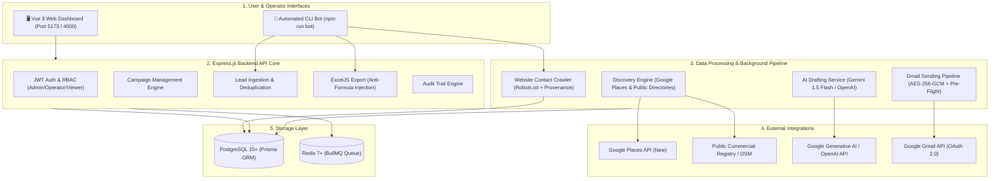
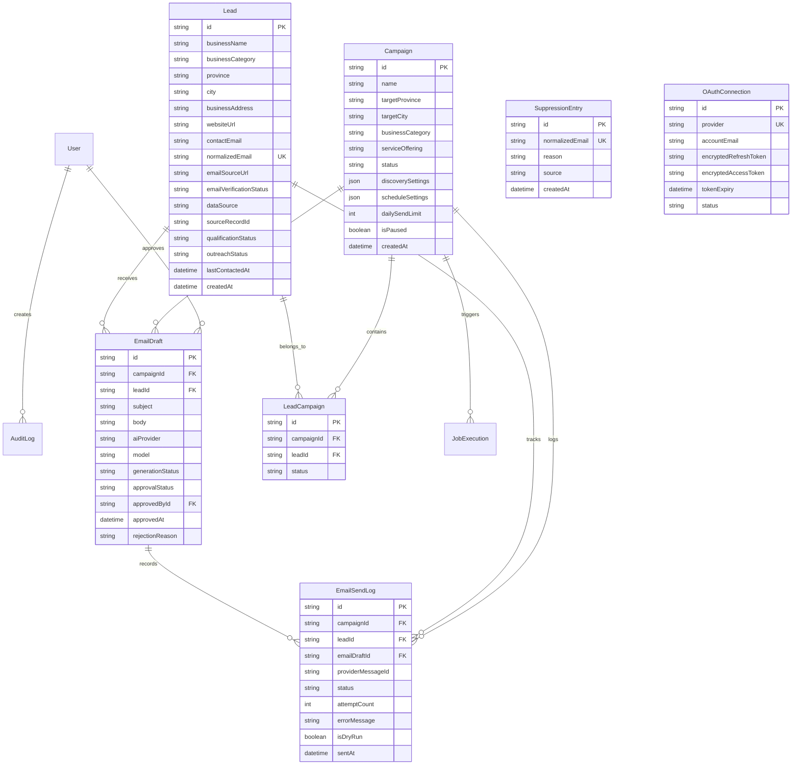
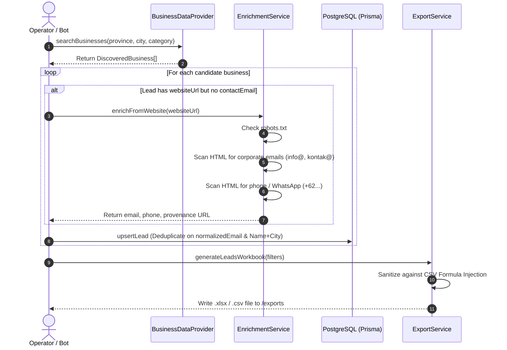

# Technical Documentation — Wardell Lead Engine
## AI-Assisted Business Lead Generation & Email Outreach Automation Platform

**Project Name:** Wardell Lead Engine  
**Target Market:** Indonesian B2B Businesses & SMEs (Web Development, Company Profiles, Web Apps, Operational Dashboards)  
**Document Version:** 1.0.0  
**Repository:** [https://github.com/Syahbintang30/automationMarketing.git](https://github.com/Syahbintang30/automationMarketing.git)  
**Main Author:** Lead Software Architect & Senior Full-Stack Engineer  

---

## 1. System Overview & Architecture

### 1.1 Objective
Wardell Lead Engine is a modular monolith application and automated CLI bot engineered for **Wardell Tech**. It discovers Indonesian business leads across provinces and regencies/cities, enriches verified public contact information (email, phone, WhatsApp) from official corporate websites, stores normalized data in PostgreSQL, exports sanitized spreadsheets (Excel `.xlsx` / `.csv`), generates personalized AI email drafts in Indonesian, enforces human-in-the-loop reviews, and executes compliant outreach via Gmail API (OAuth 2.0).

### 1.2 High-Level Architecture Diagram



---

## 2. Workspace & Monorepo Structure

The codebase is organized as an npm workspace monorepo:

```
/automatedscrapdata/
├── backend/                              # Express.js REST API, Workers & CLI Bot
│   ├── prisma/
│   │   ├── schema.prisma                 # Relational database schema
│   │   └── seed.ts                       # Seed script (Admin, Indonesian Locations, Starter Campaign)
│   ├── src/
│   │   ├── cli/
│   │   │   └── scrape-bot.ts             # Interactive / Command-Line Scraper Bot
│   │   ├── config/
│   │   │   ├── env.ts                    # Zod-validated environment schema
│   │   │   └── logger.ts                 # Pino structured logger with secret redaction
│   │   ├── db/
│   │   │   └── prisma.ts                 # PrismaClient singleton with event logging
│   │   ├── middleware/
│   │   │   ├── auth.middleware.ts        # JWT verification & RBAC guard
│   │   │   ├── error.middleware.ts       # Global error handler with formatted JSON
│   │   │   └── validate.middleware.ts    # Zod request validator (body, query, params)
│   │   ├── modules/
│   │   │   ├── ai/                       # AI draft generation, prompt templates, review routes
│   │   │   ├── audit/                    # Immutable audit logging service
│   │   │   ├── campaigns/                # Campaign CRUD, criteria & discovery trigger
│   │   │   ├── dashboard/                # Executive KPI metrics, job history, audit logs
│   │   │   ├── discovery/                # BusinessDataProvider & Google Places/Public Directory
│   │   │   ├── enrichment/               # Website crawler with robots.txt parser
│   │   │   ├── export/                   # ExcelJS XLSX/CSV exporter with sanitization
│   │   │   ├── leads/                    # Lead CRUD, normalization, deduplication
│   │   │   ├── sending/                  # Gmail OAuth2, AES-256-GCM encryption, send queue
│   │   │   └── suppression/              # Opt-out handler, unsubscribe tokens, blocklist
│   │   ├── routes/                       # /api/v1 router mounting
│   │   ├── app.ts                        # Express application instance & SPA static server
│   │   └── index.ts                      # Server listener with graceful shutdown (SIGINT/SIGTERM)
│   ├── tests/                            # Vitest + Supertest automated test suites (27 tests)
│   ├── exports/                          # Generated .xlsx and .csv files
│   ├── package.json
│   ├── tsconfig.json
│   └── vitest.config.ts
│
├── frontend/                             # Vue 3 SPA Dashboard
│   ├── src/
│   │   ├── api/
│   │   │   └── client.ts                 # Typed API client with auto-auth & export downloads
│   │   ├── assets/
│   │   │   └── main.css                  # Dark glassmorphism design system & CSS tokens
│   │   ├── router/
│   │   │   └── index.ts                  # Vue Router (8 functional views)
│   │   ├── views/
│   │   │   ├── DashboardView.vue         # Executive KPI summary & distributions
│   │   │   ├── CampaignsView.vue         # Campaign management & trigger modals
│   │   │   ├── LeadsView.vue             # Leads table, search, filters & direct export
│   │   │   ├── EmailReviewView.vue       # AI draft preview, editor, approve/reject
│   │   │   ├── SendingQueueView.vue      # Outreach message monitor & global pause toggle
│   │   │   ├── IntegrationsView.vue      # Gmail OAuth, Google Places, AI status
│   │   │   ├── JobMonitoringView.vue     # Distributed job monitor (BullMQ status)
│   │   │   └── SuppressionView.vue       # UU PDP opt-out & manual suppression list
│   │   ├── App.vue                       # Shell layout with sidebar navigation
│   │   └── main.ts                       # SPA entrypoint
│   ├── index.html
│   ├── package.json
│   ├── tsconfig.json
│   └── vite.config.ts
│
├── shared/                               # Shared TypeScript types & DTOs
│   ├── src/index.ts                      # Interfaces: LeadDTO, CampaignDTO, DraftDTO, etc.
│   ├── package.json
│   └── tsconfig.json
│
├── docker-compose.yml                    # Multi-container setup (Postgres, Redis, App)
├── ARCHITECTURE.md                       # High-level architecture specification
├── README.md                             # Setup guide and CLI cheat-sheet
├── .env.example                          # Documented environment template
└── package.json                          # Workspace root configuration
```

---

## 3. Database Schema & Data Models

Managed via **Prisma ORM** connecting to **PostgreSQL 15+**.

### 3.1 Entity Relationship Diagram



### 3.2 Key Data Integrity & Deduplication Rules
1. **`Lead.normalizedEmail` (Unique Constraint):** Trimmed, lowercased corporate email address. If a lead already exists with the same email, new discovery updates/enriches existing fields rather than creating a duplicate row.
2. **Secondary Deduplication:** If email is unverified or absent, deduplication is evaluated against `(businessName + city)` using case-insensitive matching.
3. **Compound Key `LeadCampaign(campaignId, leadId)`:** Ensures a lead is never associated with the same campaign more than once.

---

## 4. Lead Scraper & Contact Enrichment Pipeline

The discovery and enrichment engine can be triggered via **CLI Bot (`npm run bot`)**, **REST API (`POST /api/v1/campaigns/:id/discover`)**, or **Vue 3 UI**.



### 4.1 Provider Implementations
* **`GooglePlacesProvider` (`google-places-new`):**
  * Uses official Google Places API (New) Text Search (`places:searchText`).
  * **Strict Compliance Guard:** Conforms to Google Maps Platform terms. Only `place_id` is retained permanently in `sourceRecordId`. General business listing details are enriched independently for permanent CRM persistence.
* **`PublicDirectoryProvider` (`indonesia-public-directory`):**
  * Crawls open commercial directories and OpenStreetMap Nominatim endpoints for verified Indonesian business POIs.
  * Operates without requiring paid third-party API keys.
  * Contains fallback seed dataset for consistent testing and offline demos.

### 4.2 Website Enrichment Rules
* **`robots.txt` Verification:** Checks `https://<domain>/robots.txt` before crawling contact subpages. If `Disallow: /` is present, the website is respected and skipped.
* **Target Contact Subpages:** Checks `/`, `/contact`, `/contact-us`, `/kontak`, `/hubungi-kami`, `/tentang-kami`, `/about`.
* **Inbox Prioritization:** Prioritizes corporate generic mailboxes (`info@`, `kontak@`, `contact@`, `halo@`, `sales@`, `marketing@`, `support@`, `admin@`) over personal emails.
* **Provenance Guarantee:** Every discovered email permanently documents its `email_source_url` and retrieval timestamp. Hallucinated or inferred addresses are forbidden.

---

## 5. Spreadsheet Export Engine (Anti-Formula Injection)

Exporting data to Excel and CSV is handled by `ExportService` (`backend/src/modules/export/export.service.ts`) using **ExcelJS**.

### 5.1 Formula Injection Protection
When opening spreadsheet files in software like Microsoft Excel, LibreOffice, or Google Sheets, untrusted text beginning with arithmetic or formula operators can execute arbitrary commands (`=cmd|' /C calc'!A0` or `@SUM(...)`).

`ExportService.sanitizeCellValue()` detects and neutralizes this vulnerability:
```typescript
static sanitizeCellValue(value: unknown): string {
  if (value === null || value === undefined) return '';
  const str = String(value).trim();
  if (/^[=+\-@\t\r]/.test(str)) {
    return `'${str}`; // Prepend single quote to force raw text treatment
  }
  return str;
}
```

### 5.2 Exported Columns
1. `No`
2. `Business Name`
3. `Province`
4. `City / Regency`
5. `Category`
6. `Website`
7. `Business Email`
8. `Email Status` (`VERIFIED`, `UNVERIFIED`, `UNAVAILABLE`)
9. `Address`
10. `Data Source`
11. `Source Provenance URL`
12. `Campaign(s)`
13. `Qualification Status`
14. `Outreach Status`
15. `Last Contacted At`
16. `Discovered Date`

---

## 6. AI Email Drafting & Review Workflow

### 6.1 Prompt Engineering & Guardrails
Handled by `GeminiProvider` (`backend/src/modules/ai/gemini.provider.ts`) implementing `EmailGenerationProvider`:
* **Language:** Natural, respectful Indonesian by default.
* **Wardell Tech Services Offered:** Company profile websites, custom web applications, internal operational dashboards, and operational workflow digitization.
* **Prohibited AI Behaviors:**
  * Must never invent recipient names, fake business problems, or fabricated claims about previous interactions.
  * Must never promise false technical metrics without evidence.
* **Mandatory Footer:** Must include the recipient's unique unsubscribe opt-out link: `${APP_BASE_URL}/api/v1/opt-out?email=...&token=...`.
* **Structured Output:** Strictly outputs JSON containing separate `subject` and `body` fields.

### 6.2 Review State Machine
```
[PENDING] ──(Human Review / Edit)──► [APPROVED] ──► [QUEUED] ──► [SENT]
    │                                                     │
    └──(Reject)──► [REJECTED]                             └──(Opt-Out)──► [SUPPRESSED]
```
* Only drafts with `approvalStatus = 'APPROVED'` are permitted to enter the sending queue.
* The AI generation service is strictly decoupled from the dispatch API; AI models cannot approve drafts or trigger emails autonomously.

---

## 7. Outbound Sending Pipeline & Compliance Controls

### 7.1 Gmail API OAuth 2.0 & Token Encryption
* **Least Privilege Scope:** `https://www.googleapis.com/auth/gmail.send`. Mailbox reading or reading other user emails is neither requested nor permitted.
* **AES-256-GCM Encryption:** Handled by `crypto.util.ts`:
  ```
  Encrypted String Format: <IV_HEX>:<AUTH_TAG_HEX>:<CIPHERTEXT_HEX>
  ```
  OAuth refresh tokens and access tokens are encrypted using a 32-byte secret derived from `ENCRYPTION_KEY`. Plaintext tokens never appear in logs or frontend responses.

### 7.2 Pre-Flight Sending Checks
Before dispatching any message, `SendingQueueService.processApprovedQueue` validates:
1. **Global Sending Status:** Re-verifies that global sending is not paused (`GLOBAL_SENDING_PAUSED != true`).
2. **Campaign Status:** Confirms campaign is `ACTIVE` and `isPaused == false`.
3. **Approval Status:** Confirms draft is `APPROVED`.
4. **Pre-Flight Suppression Check:** Queries `SuppressionEntry` atomically. If recipient opted out, send is blocked, marked `SUPPRESSED`, and lead status is updated to `OPTED_OUT`.
5. **Duplicate-Send Guard:** Verifies no prior `EmailSendLog` with `status == SENT` exists for the same `(campaignId, leadId)` tuple.
6. **Daily Cap Enforcement:** Verifies today's sent count is less than `Campaign.dailySendLimit` (default conservative cap: 25–30 emails/day).
7. **Dry-Run Guard:** If `DRY_RUN=true`, dispatches are simulated with a mock ID (`dry-run-xxx`), logging simulation details while preventing live network calls to Google's SMTP/API servers.

### 7.3 Indonesian PDP Law (UU No. 27/2022) Opt-Out Mechanism
* Every message includes a cryptographically signed link:
  ```
  GET /api/v1/opt-out?email=<EMAIL>&token=<HMAC_SHA256_TOKEN>
  ```
* When clicked, the backend validates the token, inserts the address into `SuppressionEntry`, updates all matching lead records to `OPTED_OUT`, and renders a responsive Indonesian confirmation card.

---

## 8. REST API Reference

All endpoints are versioned under `/api/v1` and return standard JSON wrappers.

### 8.1 Authentication & Health
| Endpoint | Method | Auth | Description |
|---|---|---|---|
| `/api/v1/health` | GET | Public | Liveness probe, uptime, dry-run flag |
| `/api/v1/ready` | GET | Public | Readiness probe (PostgreSQL & Redis health) |
| `/api/v1/auth/login` | POST | Public | Operator login; returns JWT |
| `/api/v1/auth/me` | GET | Bearer | Get authenticated operator profile |

### 8.2 Dashboard & Metrics
| Endpoint | Method | Auth | Description |
|---|---|---|---|
| `/api/v1/stats` | GET | Bearer | Executive KPI metrics & province/category counts |
| `/api/v1/jobs` | GET | Bearer | Paginated BullMQ background job history |
| `/api/v1/audit-logs` | GET | Bearer | Paginated audit trail of user and system actions |

### 8.3 Campaigns
| Endpoint | Method | Auth | Description |
|---|---|---|---|
| `/api/v1/campaigns` | GET | Bearer | List all campaigns with lead counts |
| `/api/v1/campaigns/:id` | GET | Bearer | Get single campaign detail |
| `/api/v1/campaigns` | POST | Bearer | Create campaign with location & category criteria |
| `/api/v1/campaigns/:id` | PUT | Bearer | Update campaign criteria, daily limits, or status |
| `/api/v1/campaigns/:id/pause` | POST | Bearer | Pause campaign outreach |
| `/api/v1/campaigns/:id/resume` | POST | Bearer | Resume campaign outreach |
| `/api/v1/campaigns/:id/discover` | POST | Bearer | Trigger automated scraper for campaign |
| `/api/v1/campaigns/:id/drafts` | POST | Bearer | Trigger AI draft generation for campaign leads |

### 8.4 Leads & Exports
| Endpoint | Method | Auth | Description |
|---|---|---|---|
| `/api/v1/leads` | GET | Bearer | Filter leads (search, province, city, category, status) |
| `/api/v1/leads/:id` | GET | Bearer | Get lead detail with campaign, draft, and log relations |
| `/api/v1/leads` | POST | Bearer | Upsert single lead with deduplication |
| `/api/v1/leads/:id/status`| PATCH | Bearer | Update lead qualification or outreach status |
| `/api/v1/exports/leads` | GET | Bearer | Stream `.xlsx` or `.csv` export with formula sanitization |

### 8.5 Email Drafts & Review
| Endpoint | Method | Auth | Description |
|---|---|---|---|
| `/api/v1/drafts` | GET | Bearer | List drafts with approvalStatus filter |
| `/api/v1/drafts/:id` | GET | Bearer | Get draft detail |
| `/api/v1/drafts/:id` | PUT | Bearer | Update subject or body manually |
| `/api/v1/drafts/:id/approve` | POST | Bearer | Approve draft for sending queue |
| `/api/v1/drafts/:id/reject` | POST | Bearer | Reject draft with reason |

### 8.6 Sending Queue & Integrations
| Endpoint | Method | Auth | Description |
|---|---|---|---|
| `/api/v1/sending-queue` | GET | Bearer | List outbound message send logs |
| `/api/v1/sending-queue/process` | POST | Bearer | Trigger approved queue send with pre-flight checks |
| `/api/v1/sending-queue/pause` | POST | Bearer | Pause outbound email dispatch globally |
| `/api/v1/sending-queue/resume` | POST | Bearer | Resume outbound email dispatch globally |
| `/api/v1/opt-out` | GET | Public | Public unsubscribe link handler (UU PDP compliance) |
| `/api/v1/suppression-list` | GET | Bearer | List suppressed contacts |
| `/api/v1/suppression-list` | POST | Bearer | Add email to suppression blocklist manually |
| `/api/v1/integrations/gmail/status` | GET | Bearer | Check Gmail OAuth connection status |
| `/api/v1/integrations/gmail/auth-url` | GET | Bearer | Generate Google OAuth 2.0 authorization URL |
| `/api/v1/integrations/gmail/callback` | POST | Bearer | Exchange OAuth code for encrypted refresh token |

---

## 9. Automated Testing & Verification

Automated tests are implemented using **Vitest** and **Supertest** (`backend/tests/`).

### Test Coverage Summary (27 Passing Tests):
* **`health.test.ts` (3 tests):**
  * Liveness probe `/api/v1/health`.
  * Database readiness probe `/api/v1/ready`.
  * Single Page Application root index serving (`GET /`).
* **`auth.test.ts` (3 tests):**
  * Invalid credentials rejection (401).
  * Valid login & JWT issuance.
  * Protected route token verification (`GET /api/v1/auth/me`).
* **`leads_and_export.test.ts` (5 tests):**
  * Campaign retrieval from seeded database.
  * Lead deduplication via normalized email & name/city.
  * CSV/Excel formula injection sanitization.
  * XLSX streaming attachment validation.
  * CSV streaming attachment content verification.
* **`discovery_and_enrichment.test.ts` (4 tests):**
  * Google Places API compliance policy enforcement (`place_id` only).
  * Public directory search & structured schema validation.
  * Website crawler graceful handling of offline/invalid domains.
  * Campaign-driven automated discovery & junction linking.
* **`drafts_and_ai.test.ts` (4 tests):**
  * AI draft generation for eligible leads.
  * Opt-out link presence in draft body.
  * Human-in-the-loop draft editing.
  * Draft approval state transition to `APPROVED`.
* **`sending_and_suppression.test.ts` (5 tests):**
  * AES-256-GCM symmetric encryption & decryption roundtrip.
  * RFC 2822 base64url MIME message compilation.
  * Cryptographic opt-out verification and suppression persistence.
  * Global sending pause/resume toggling.
  * Safe queue processing under `DRY_RUN` mode.
* **`dashboard.test.ts` (3 tests):**
  * Executive KPI calculations and distribution grouping.
  * Background job execution history pagination.
  * Audit log pagination.

To execute tests:
```bash
npm --workspace=@wardell/backend run test
```

---

## 10. Operational Runbook

### 10.1 Running the Automated Scraper Bot
```bash
# General search
npm run bot

# Custom targeted scraping directly to Excel (.xlsx)
npm run bot -- --province="Jawa Barat" --city="Kota Bandung" --category="Hotel & Resto" --limit=30 --format=xlsx

# Direct export to CSV
npm run bot -- --province="DKI Jakarta" --city="Jakarta Pusat" --category="Konsultan IT" --limit=25 --format=csv
```
Output files are placed in `/backend/exports/`.

### 10.2 Starting Development Servers
```bash
# Terminal 1: Backend API Server
npm run dev:backend

# Terminal 2: Frontend SPA Dev Server
npm run dev:frontend
```

### 10.3 Production Deployment Steps
1. Configure environment variables in `.env`.
2. Run database migrations: `npm --workspace=@wardell/backend run prisma:push`.
3. Seed baseline datasets: `npm --workspace=@wardell/backend run prisma:seed`.
4. Build frontend SPA bundle: `npm --workspace=@wardell/frontend run build`.
5. Build backend bundle: `npm --workspace=@wardell/backend run build`.
6. Start production server: `npm --workspace=@wardell/backend run start`.
7. The application serves both the API and the compiled Vue 3 SPA on `http://localhost:4000`.
